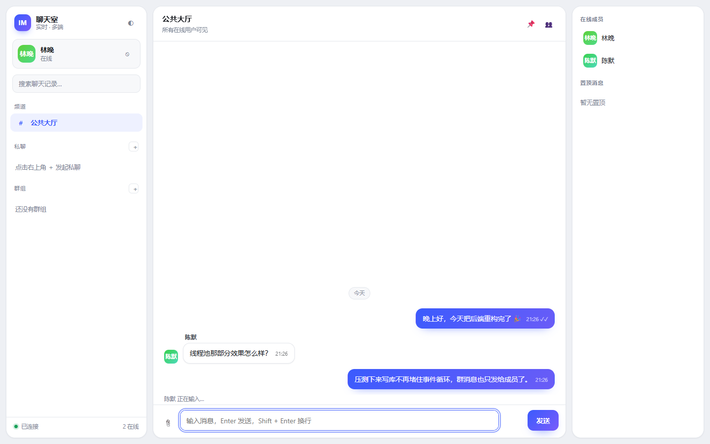
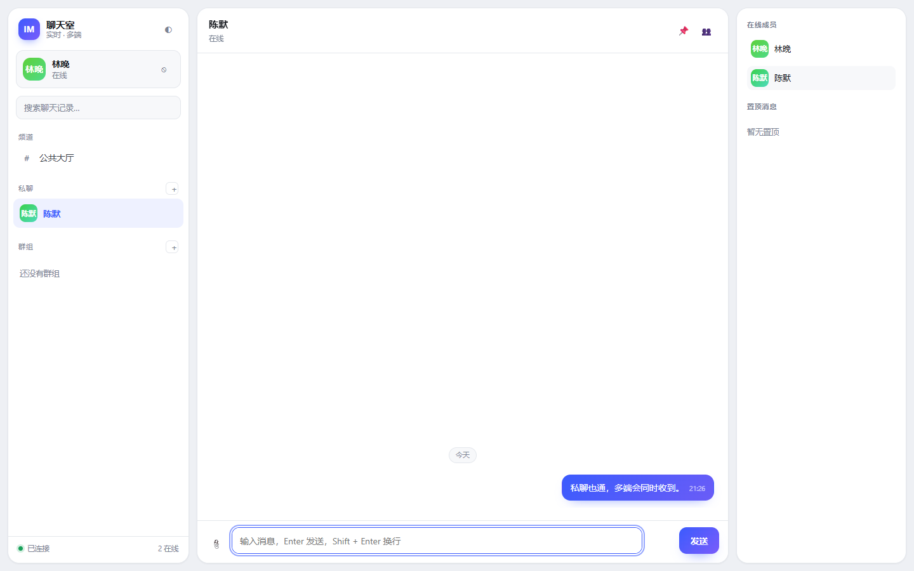
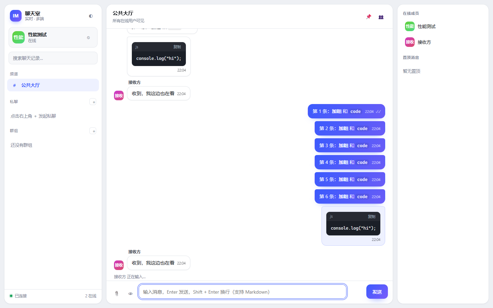
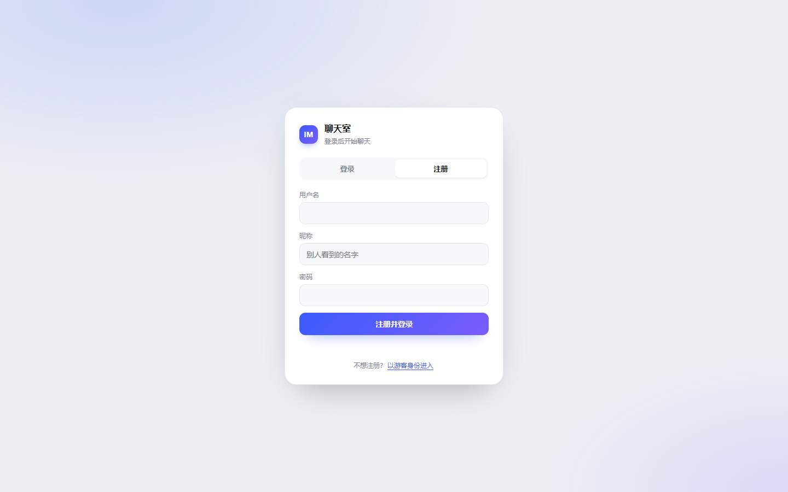
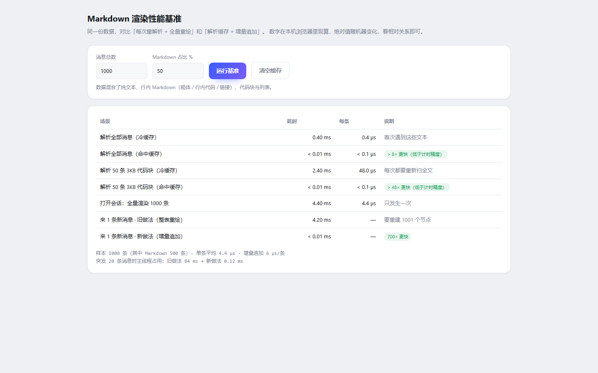

# IM Chat Server

C++20 实时 IM 聊天室：Boost.Beast WebSocket 后端 + 内置 Web 客户端。

| 服务 | 默认地址 | 说明 |
|------|----------|------|
| WebSocket | `ws://0.0.0.0:8080` | 聊天协议（Android 客户端沿用此端点） |
| HTTP | `http://0.0.0.0:8081/` | Web 客户端、健康检查、文件上传 |

## 功能

**聊天**
- 公共大厅、一对一私聊、多人群组
- 消息编辑 / 撤回 / 删除、置顶、收藏、全文搜索
- 已读回执、输入状态、在线成员、文件与图片消息
- 会话令牌（session token）恢复登录，**同一账号多设备同时在线**
- **消息支持 Markdown**：代码块（带复制按钮）、列表、引用、标题、粗体/斜体、
  行内代码、链接与图片；输入框可实时预览

**工程**
- 分片线程池：阻塞的 SQLite 操作不占用 Reactor 线程，且同一连接的命令严格有序
- 精确投递：群消息只发给群成员，私聊只发给双方，不再全站广播
- 令牌桶限流（消息 + 登录），超时与慢消费者保护
- SQLite WAL + 预编译语句缓存 + NORMAL 同步
- libsodium Argon2id 密码哈希、加密随机 ID / 会话令牌
- 优雅退出：先停接入，再排空队列，最后关库

## 目录结构

```
include/imchat/     头文件（config / chat_room / session_manager / http_server …）
src/                实现
web/                Web 客户端（原生 HTML + CSS + JS，无需构建）
tools/e2e.js        端到端冒烟测试（Node 18+，需内置 WebSocket）
config/config.json  运行配置
docs/               协议、架构与构建文档
```

## 依赖

| 库 | 用途 |
|----|------|
| Boost.Beast / Asio | WebSocket + HTTP |
| nlohmann/json | JSON |
| spdlog + fmt | 日志 |
| SQLite3 | 持久化 |
| libsodium | 密码哈希 / 随机数 |

## 界面

| 聊天 | 私聊 |
|------|------|
|  |  |

| Markdown 渲染 | 登录 / 注册 |
|------|------|
|  |  |

## 性能

消息列表不是「每来一条就整表重绘」，而是：

- **解析缓存**：Markdown 结果按原文缓存（FIFO，600 条），重复渲染不再跑正则；
- **增量追加**：新消息只插入一个 DOM 节点，O(1) 而不是 O(n)；
- **事件委托**：点击/复制/菜单全部委托到容器，不再为每个节点绑事件；
- **按需重绘**：已读回执只加一个 class，同一帧内的事件合并成一次渲染。

自带对比页 <http://127.0.0.1:8081/bench.html>，打开即可现场测量：

| 场景 | 优化前 | 优化后 |
|---|---|---|
| 收到 1 条新消息（1000 条在屏） | 整表重建 ≈ 4 ms | 追加一个节点 < 0.01 ms |
| 重复渲染同一批消息 | 每次重扫 Markdown ≈ 0.3 ms | 命中缓存 ≈ 0.1 ms |
| 重复渲染 3KB 代码块 | 52 µs/条 | < 0.1 µs/条 |



## 构建

MSYS2（MinGW-w64）或任意安装了上述依赖的 C++20 工具链：

```bash
pacman -S mingw-w64-ucrt-x86_64-toolchain mingw-w64-ucrt-x86_64-cmake \
          mingw-w64-ucrt-x86_64-ninja  mingw-w64-ucrt-x86_64-boost \
          mingw-w64-ucrt-x86_64-nlohmann-json mingw-w64-ucrt-x86_64-spdlog \
          mingw-w64-ucrt-x86_64-sqlite3 mingw-w64-ucrt-x86_64-libsodium
```

```bash
bash build.sh Release
```

依赖不在默认搜索路径时，用 `CMAKE_PREFIX_PATH` 指向前缀目录：

```bash
cmake -S . -B build -G Ninja -DCMAKE_BUILD_TYPE=Release \
      -DCMAKE_PREFIX_PATH=/path/to/prefix
cmake --build build
```

## 运行

```bash
./build/im_chat_server.exe ./config/config.json
```

浏览器打开 <http://127.0.0.1:8081/> 即可使用 Web 客户端；Android 客户端仍连接 `ws://<ip>:8080`。

## 配置

`config/config.json`（缺省项均有内置默认值，可只写需要覆盖的字段）：

| 键 | 默认 | 说明 |
|----|------|------|
| `host` / `port` | `0.0.0.0` / `8080` | WebSocket 监听 |
| `http_port` | `8081` | HTTP 监听；与 `port` 相同时自动禁用 HTTP |
| `web_root` | `web` | 静态资源目录 |
| `upload_dir` | `uploads` | 上传文件目录 |
| `message_max_length` | `500` | 单条消息最大字符数（按 Unicode 码点计） |
| `max_ws_message_bytes` | `65536` | 单个 WebSocket 帧上限 |
| `max_upload_bytes` | `8388608` | 上传文件上限 |
| `rate_limit_msgs_per_sec` / `rate_limit_burst` | `10` / `20` | 消息令牌桶 |
| `auth_attempts_per_sec` / `auth_burst` | `1` / `5` | 登录/注册令牌桶 |
| `io_threads` / `worker_threads` | `0` / `0` | 0 = 按 CPU 自动 |

## 接口

- WebSocket 消息格式：`docs/API_PROTOCOL.md`
- HTTP：`GET /api/health`、`GET /api/stats`、`POST /api/upload?name=<文件名>`

## 测试

```bash
node tools/e2e.js
```

覆盖注册、公聊、私聊、群组、历史、编辑、撤回、越权拦截、限流、中文搜索、
会话恢复与多端投递。

## 安全说明

- 密码使用 Argon2id（libsodium `crypto_pwhash_str`）
- 会话令牌为 256 位加密随机数
- 消息、文件名、用户昵称在客户端全部转义后渲染
- HTTP 静态服务做了路径穿越校验
